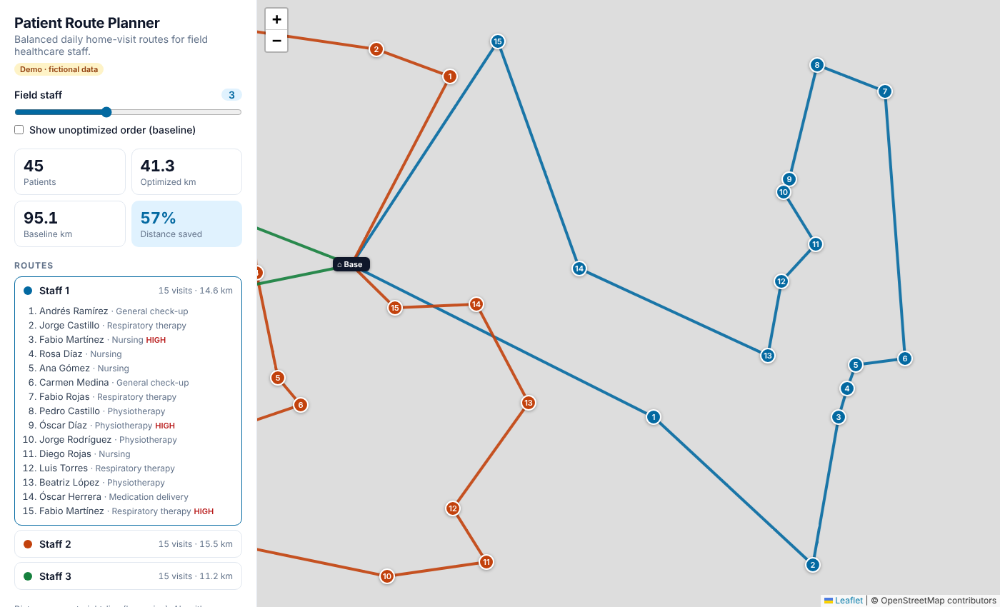

# 🗺️ Patient Route Planner

Plans **balanced daily home-visit routes** for field healthcare staff: splits a list of patients among N caregivers and orders each caregiver's visits to minimize travel distance.

Inspired by a georeferencing system I built in production for a home-healthcare provider. This is a clean-room public version: **all data is fictional** and generated by a script.

**[▶ Live demo](https://mariocastro-dev.github.io/patient-route-planner/)**



## The problem

A home-healthcare company sends nurses, physiotherapists and respiratory therapists to patients' homes every day. Two questions decide how much time they spend driving instead of caring:

1. **Who visits whom?** Workloads should be fair, and each caregiver should cover one area of the city.
2. **In what order?** This is the classic Traveling Salesman Problem (NP-hard), so an exact solution doesn't scale; good heuristics do.

## How it works

```
patients ──► balanced k-means++ ──► nearest neighbor ──► 2-opt ──► routes
             (who visits whom)      (initial route)      (remove crossings)
```

| Step | What it does | Complexity |
|---|---|---|
| **k-means++ init** | Picks well-spread initial centers, weighted by squared distance | O(n·k²) |
| **Balanced assignment** | Assigns patients to the nearest center, capped at ⌈n/k⌉ per caregiver, so no one gets 25 visits while someone else gets 5 | O(n·k·log(n·k)) per iteration |
| **Nearest neighbor** | Greedy route: always go to the closest unvisited patient | O(n²) |
| **2-opt** | Reverses route segments whenever that shortens the tour, until no improving move exists | O(n²) per pass |

Distances use the **haversine** formula (great-circle distance on the Earth's surface).

### Results on the demo dataset (45 patients)

| Caregivers | Visiting in record order | Nearest neighbor | **NN + 2-opt** | 2-opt gain over greedy |
|---|---|---|---|---|
| 1 | 151.4 km | 35.8 km | **31.6 km** | 11.6% |
| 3 | 95.1 km | 47.7 km | **41.3 km** | 13.5% |
| 5 | 80.4 km | 52.1 km | **46.3 km** | 11.1% |

The "record order" baseline is what happens when visits are done in the order patients appear in the list. The demo's toggle draws it as dashed lines so you can see the difference.

### Design decisions and trade-offs

- **Balance over compactness.** The capacity cap means some clusters overlap slightly. For field staff, a fair workload matters more than a perfectly tight zone.
- **Heuristics over exact solvers.** 2-opt gets within a few percent of optimal for routes of this size in milliseconds, in the browser, with no server.
- **Deterministic.** A seeded PRNG makes clustering reproducible, which makes it testable.
- **No API keys.** Map tiles come from OpenStreetMap via Leaflet, so the demo runs on GitHub Pages with nothing secret in the repo. The production version used the Google Maps API.

## Run it locally

```bash
git clone https://github.com/mariocastro-dev/patient-route-planner.git
cd patient-route-planner
npm start          # serves the app at http://localhost:3000
npm test           # runs the unit tests (Node 18+, no dependencies)
npm run generate-data   # regenerates the fictional dataset
```

## Project structure

```
src/
  geo.js          haversine distance, route length
  clustering.js   balanced k-means++
  routing.js      nearest neighbor + 2-opt
  planner.js      orchestrates clustering + routing, computes the baseline
  app.js          Leaflet map UI
  rng.js          seeded PRNG
tests/            node:test unit tests
scripts/          fictional data generator
data/             generated dataset
```

## Next steps

- Real road distances using a routing engine (OSRM or Google Distance Matrix) instead of straight lines
- Time windows and visit durations (VRPTW)
- Prioritizing high-priority patients earlier in the day
- Or-opt moves and simulated annealing to escape 2-opt local minima

## Author

**Mario Fernando Castro Acosta** · Full-Stack Developer · [LinkedIn](https://www.linkedin.com/in/mario-fernando-castro-acosta-95b05720b) · [GitHub](https://github.com/mariocastro-dev)

MIT License
